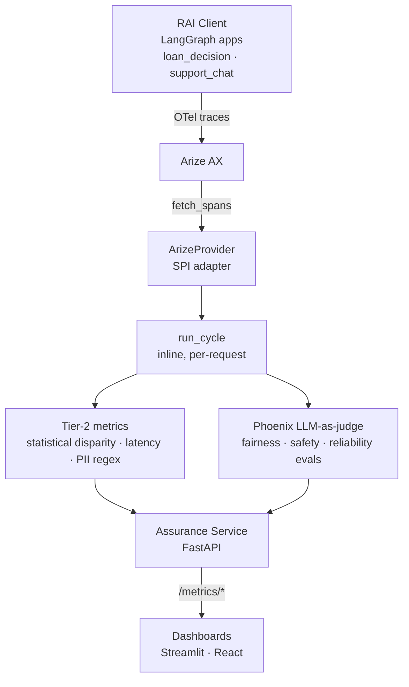

# RAI Observability & Assurance Service

Demo-quality slice of the **RAI Trust Platform's Observability & Assurance Service**.

---

## Prerequisites

- Python 3.11+
- An [Arize](https://app.arize.com) account (Space ID + API key)
- OpenAI **or** Anthropic API key
- *(Day 1 optional)* Azure Content Safety key + endpoint

---

## Quickstart (< 10 min)

### 1 · Install

```bash
cd rai-assurance
pip install -e ".[dev]"
```

### 2 · Configure environment

```bash
cp .env.example .env
# Fill in ARIZE_API_KEY, ARIZE_SPACE_ID, and at least one LLM key.
```

> **⚠️ `ARIZE_SPACE_ID` must be the Space ID of the space that holds your project, and it
> must be a *Space* ID — not a Model/project GID.**
>
> - In the Arize console: **Settings → Space Settings → Space ID**. It is a different value
>   than the model/project id shown on a project page. When base64-decoded a Space ID starts
>   with `Space:` (e.g. `U3BhY2U6NDMwMzE6VzZ4Ng==` → `Space:43031`); a Model GID decodes to
>   `Model:…` and will **not** work (auth passes but ingestion/pull fails with `INTERNAL` /
>   "model does not exist").
> - It must be the **same space the traced app exports to** — the pull side
>   (`ARIZE_SPACE_ID` here) and the push side (myBank's `OTEL_EXPORTER_OTLP_HEADERS`
>   `arize-space-id`/`space_id`) must point at the **same** space, or the spans land somewhere
>   Assurance never queries.
> - Don't confuse it with the **project/model name** (`mybank`) — that is set separately via
>   `OTEL_RESOURCE_ATTRIBUTES` on the exporting app, not in the Space ID.
> - To find the right Space ID with just the API key, see `docs/SETUP_FIXES_AND_FINDINGS.md` §12.1.

### 3 · Start the Assurance API

```bash
uvicorn assurance.api.main:app --reload --port 3010
# → http://localhost:3010/healthz
# → http://localhost:3010/v1/docs
```

### 4 · Run the smoke test (Day 1)

```bash
python scripts/smoke.py
```

Expected output:
```
Using provider: anthropic
LLM response: 'Hi!'
Flushing spans to Arize... done.

Smoke test PASSED.
→ Open Arize and verify a span named 'smoke-test' exists in project 'rai-assurance-smoke'.
```

### 5 · Run the full simulation (Day 6+)

```bash
python -m rai_client.simulator --accelerated   # ~24 simulated minutes
sleep 900                                        # let one 15-min eval cycle run
python scripts/daily_report.py
```

---

## Assurance Layer Architecture



> **Note:** Real-time observability (runtime guardrails / policy decisions) will be added once the guardrail-service is merged in.

---

## Day-by-day progress

| Day | Scope | Status |
|-----|-------|--------|
| 1 | Scaffold · tracing · smoke test | ✅ |
| 2 | RAI Client — loan & support LangGraph apps | ✅ |
| 3 | Provider SPI + Arize adapter + MetricResult | ✅ |
| 4 | Tier 2 jobs (12 metrics) | ✅ |
| 5 | Assurance Service API (4 routes) | ✅ |
| 6 | 1-day simulation + daily_report | ✅ |
| 7 | Notebook · tests · retro | ✅ |
| 8 | Streamlit dashboard (RAI health UI) | ✅ |
| 9 | Phoenix local OTel viewer (SQLite sink, dev/debug) | — |
| 10 | End-to-end walkthrough (developer onboarding guide with venv notes) | — |
| 11 | RAI product spec review — expand metrics, improve intuition | — |
| 12 | React JS dashboard (replace/complement Streamlit) | — |
| 13 | Dockerfile + docker-compose for local container run | — |
| 14 | GitHub repo creation + CI (pytest on push) | — |
| 15 | Deploy to GCP Cloud Run or Azure Container Apps (public endpoint) | — |

---

## Env vars reference

| Variable | Required | Description |
|----------|----------|-------------|
| `ARIZE_API_KEY` | ✅ | Arize personal API key |
| `ARIZE_SPACE_ID` | ✅ | **Space ID of the Arize space that contains your project** (e.g. the `mybank` project). Must be the *Space* ID (base64-decodes to `Space:…`), **not** a Model/project GID (`Model:…`), and must match the space the traced app exports to. See "Arize Space ID" note below. |
| `AZURE_CS_KEY` | Day 1+ | Azure Content Safety API key |
| `AZURE_CS_ENDPOINT` | Day 1+ | Azure CS endpoint URL |
| `OPENAI_API_KEY` | one of two | OpenAI key |
| `ANTHROPIC_API_KEY` | one of two | Anthropic key |
| `ASSURANCE_PROVIDER` | optional | `arize` (default) or `mock` |
| `JUDGE_MODEL` | Day 4+ | LLM-as-judge: `claude-haiku-4-5` / `gpt-4o-mini` |
